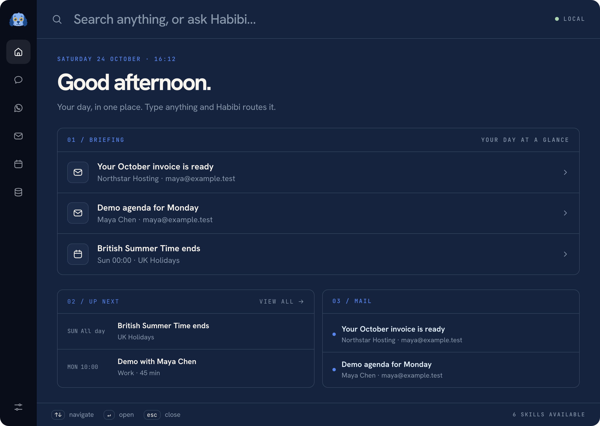
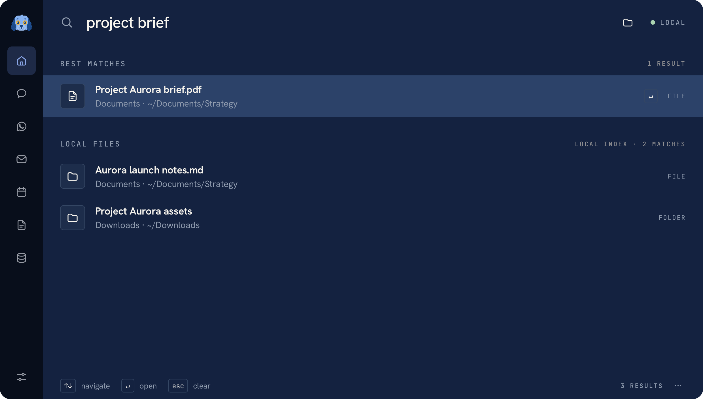
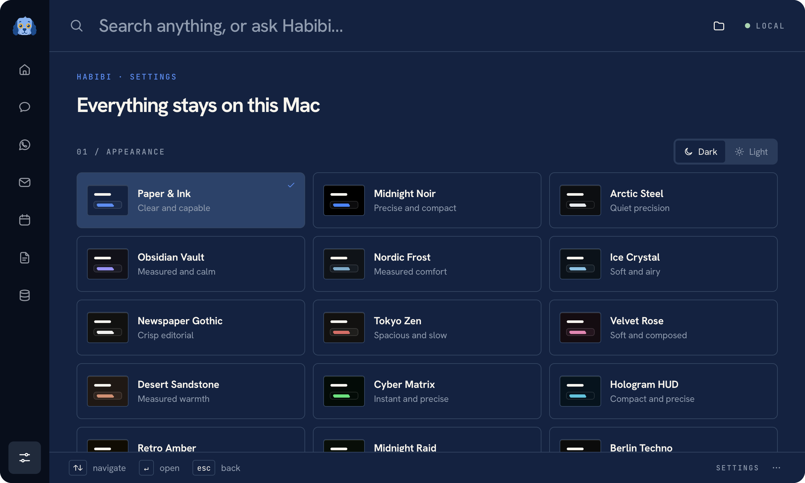
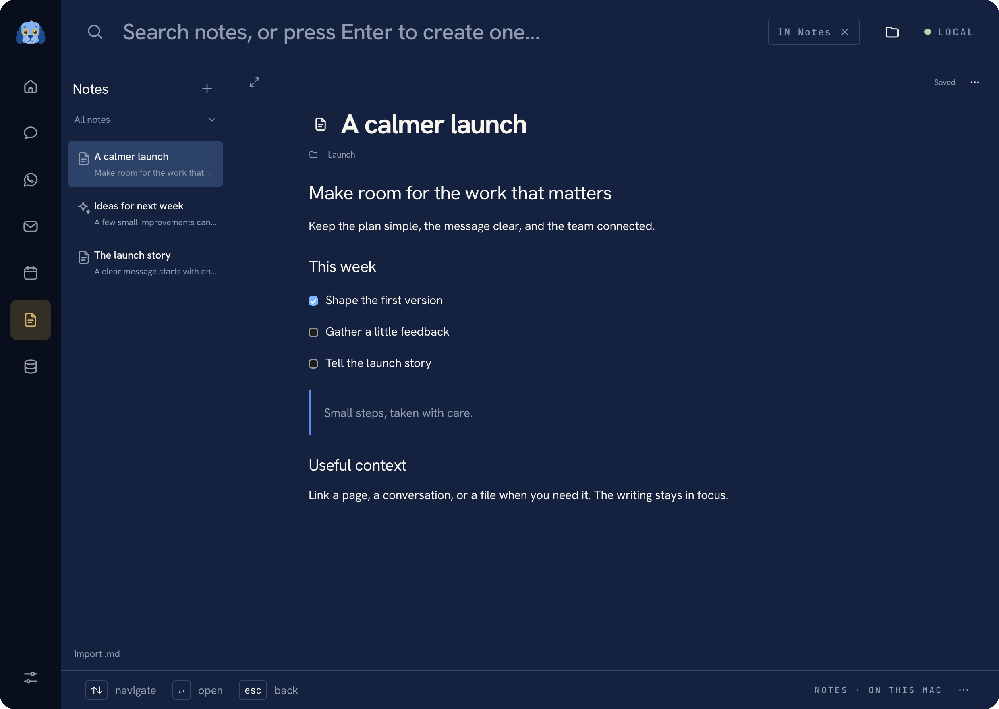
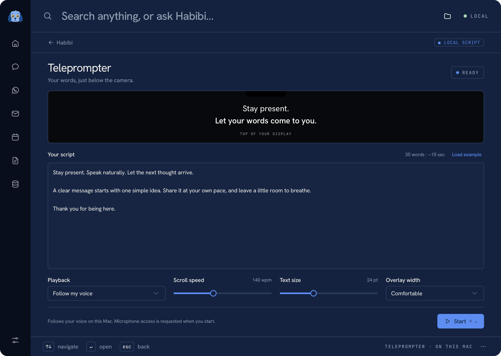

<p align="center">
  
</p>

<h1 align="center">Habibi</h1>

<p align="center">
  <strong>A private, local-first command center for macOS, Windows, and Linux.</strong><br />
  Search, act, and ask—without turning your desktop into a browser tab.
</p>

<p align="center">
  <kbd>⌥ Space</kbd> / <kbd>Alt Space</kbd>&nbsp; Search anything &nbsp;·&nbsp; Ask Habibi &nbsp;·&nbsp; Open a capability
</p>

<p align="center">
  An open-source project by <a href="https://github.com/clidey">Clidey, Inc.</a>
</p>

Habibi is a fast keyboard launcher for the things that normally require opening
five apps: finding a file, reading a mail thread, checking your calendar,
messaging someone, opening an agent session, or asking a model to help. It runs
as a desktop app with a Rust backend in a Tauri shell—not a cloud dashboard.
macOS is the most complete platform today; see [Platform support](#platform-support)
for what works on Windows and Linux.

**One rule governs every integration:** nothing external is sent, created, or
changed without a clear user action and fresh approval.

## Documentation

Read the [Habibi documentation](https://clidey.github.io/habibi/).

The [Habibi documentation](docs/introduction.mdx) covers setup, every workspace,
privacy, troubleshooting, and development. It is built with
[Dory](https://github.com/clidey/dory).

```sh
pnpm install
pnpm run docs:dev       # local documentation preview
pnpm run docs:check     # links, navigation, assets, and MDX
pnpm run docs:build     # static site in docs/dist/
```

## See it in action

Habibi opens into a useful, quiet briefing—not an empty search box. From there,
you can move entirely with the keyboard into local search, connected apps, or
private chat.

<p align="center">
  
</p>

| Local search                                                                                             | Yours to shape                                                                                    |
| -------------------------------------------------------------------------------------------------------- | ------------------------------------------------------------------------------------------------- |
|                  |               |
| **Fast, relevant results.** Apps, folders, and files are ranked for the intent—not dumped from an index. | **Personal on purpose.** Choose a theme, launcher shortcut, and how much context appears on Home. |

> Every screenshot is Habibi’s real UI in a sealed fictional-data demo mode.
> Run `pnpm exec playwright install chromium` once, then generate them with
> `pnpm generate:demo-screenshots`; no account,
> connector, file, or desktop data is captured for this repository.

## Why it feels different

- **Fast on the obvious path.** Search uses a bounded, in-memory filename index,
  cached service metadata, and direct application discovery. No Spotlight,
  model calls, content reads, or repeated disk scans on the warm search path.
  Filesystem notifications update changed directories without a polling timer.
- **Private by default.** There is no local web server: the UI talks to the
  Rust backend over the app's own IPC. Connector credentials stay in your
  system credential store and sessions stay on your computer.
- **Agent-native, not agent-only.** Use Ollama or LM Studio locally, or bring
  your own OpenAI, Anthropic, or Gemini key. Direct answers stay direct; a
  model is there when it is useful, not as the launcher itself.
- **Permissionful by design.** Reads are scoped. Sends, calendar writes,
  and system actions require a fresh, single-use approval.
- **Keyboard-first everywhere.** Arrow keys, Enter, Escape, focus management,
  and shortcut recording are shared across every surface.
- **Built to extend.** Integrations are permission-scoped skills with typed
  contracts, runtime validation, and a consistent launcher/search contract.

## Search performance and scope

The filename index starts on the first file search. It covers Desktop, Documents,
Downloads, Projects, Developer, and Code, with a 30,000-entry memory bound,
4,000-directory budget per root, and eight directory levels. It excludes hidden
folders, symlinks, app bundles, dependencies, caches, and build outputs. Search
settings shows index status, unavailable folders, truncation, and manual refresh.
Global Mail and Calendar matches use already loaded metadata; scoped Mail search
queries the connected provider when requested.

Change notifications come from FSEvents on macOS, inotify on Linux, and
`ReadDirectoryChangesW` on Windows; where a watch is unavailable, use the manual
refresh (there is no polling fallback).

The shell uses the WhoDB EE Hanken Grotesk / JetBrains Mono typography and
Clidey UX theme tokens. Paper & Ink is the default theme; existing Clidey Ink
selections migrate to it automatically. Refresh the checked-in token snapshot with
`node scripts/sync-whodb-themes.mjs [path/to/ux]`. The application has
no runtime dependency on a WhoDB checkout.

Icons come from the published `@clidey/ux` catalog. Named React icons and
template icon hydration share the same library artwork. Loading states use
Clidey UX’s animated mark; animations pause when the page is hidden and respect
reduced-motion preferences. No animation timers or extra network requests are needed.

WhoDB’s connected workspace provides Ask and Apps tabs, an organization/project
picker, a single data conversation, and read-only results with tables, small charts,
returned-row statistics, SQL (when provided), provenance, and tool traces.
Only fixed GraphQL read queries or explicitly read-only, allowlisted MCP tools
can run. Model plans cannot change the selected host/organization/project or
execute a write. MCP clients close after each action; there is no WhoDB polling
or idle process. A question has
an eight-model-step budget; tables are capped at 100 returned rows. All-project
requests cover up to 12 projects and disclose truncation.

Choose **WhoDB → Sign in with SSO** to connect to `https://app.whodb.com`, or
enter your own instance URL. This uses the CLI’s OIDC discovery and browser
authorization-code flow with S256 PKCE, state validation, and a temporary
loopback callback. Tokens stay in the system credential store (Keychain,
Credential Manager, or Secret Service) and refresh only when a workspace request
needs them. Sign-in waits on one pending response rather than polling.
Credentials never enter process arguments. The built-in adapter uses the CLI’s fixed GraphQL read operations
for organizations, projects, apps, ontology descriptions, and bounded queries.

For an existing custom MCP setup, configure `.habibi/mcp-servers.json` in
Habibi's data directory (see [Local data](#local-data); `HABIBI_DATA_ROOT`
overrides it):

```json
{
  "servers": [{
    "id": "whodb",
    "name": "WhoDB",
    "transport": "stdio",
    "command": "whodb",
    "args": ["mcp", "serve", "--read-only"]
  }]
}
```

Sign in with the WhoDB CLI first, then select the MCP connection on Habibi’s
WhoDB screen under **Advanced: custom MCP connection** and press **Connect MCP**.
The custom connection continues to own its authentication.
Data questions explicitly use the configured model for planning and summarizing
returned data, including ontology metadata when the question needs it. The connected
screens are verified with fixtures and a sealed demo; live access depends on
the user’s sign-in or configured MCP server and platform permissions.

## One launcher, many local surfaces

| Search or type                             | Habibi opens                                                                          |
| ------------------------------------------ | ------------------------------------------------------------------------------------- |
| `passport`, `Downloads`, `deck pdf`        | Relevant local files and folders, with preview, reveal, and attach.                   |
| `WhatsApp`, `message Sam`, `ping the team` | Local chats, recents, history, and a draft before any send.                           |
| `mail`, `invoice from Maya`                | Connected IMAP inboxes, safe thread rendering, reply drafts, and provider deep links. |
| `next Friday 2–3 meeting Raj`              | A calendar draft to review before creation.                                           |
| `find a hotel in St Ives next weekend`     | A refined browser search when there is enough context to search well.                 |
| `what is FOC?`                             | A direct private answer from the configured model—no unnecessary browser search.      |
| `Kubernetes`, `Codex`, `Claude`            | Read-only cluster inspection and local agent-session discovery.                       |
| `Teleprompter`                            | Paste a script and read from a floating overlay below the camera.                      |

## What it can do today

| Capability                            | Experience                                                       | Safety model                                 |
| ------------------------------------- | ---------------------------------------------------------------- | -------------------------------------------- |
| Files                                 | Search local files, preview, open/reveal, attach to a draft      | Metadata stays local                         |
| Calendar                              | See upcoming events and prepare create/update drafts             | Explicit approval before writes              |
| WhatsApp ([setup](#connect-whatsapp)) | Local OpenWA connection, recents, chat history, drafts           | Explicit approval before sends; experimental |
| Mail                                  | Gmail and Zoho IMAP inboxes, search, threads, open in provider   | Credentials stay on your computer            |
| Browser                               | Intent-aware Google, Airbnb, ChatGPT, Claude, and Gemini opening | Only reviewed allow-listed URLs open         |
| Habibi chat                           | Ephemeral conversation, attachments, pasted screenshots/text     | Configurable local or bring-your-own model   |
| Agent Dock                            | Discover and open local Codex / Claude Code sessions             | User-initiated terminal launch               |
| Notes                                 | Markdown, folders, backlinks, mail and WhatsApp links, import/export | Notes and drafts stay on this computer     |
| Teleprompter                           | Floating script reader with adjustable pace, text size, and width | Script stays local; no model required         |

You can hide or show the menu bar icon (the tray icon on Windows and Linux) in
**Settings → Menu bar → Show menu bar icon**. The preference takes effect
immediately and persists across launches. Your launcher shortcut still works with
the icon hidden; launching Habibi again also brings up the window.

## Notes

Open **Notes** from the sidebar or launcher. Create a page with **+**, write plain
Markdown with formatting rendered as you type. Select text to format it, or type
`/` for headings, lists, checkboxes, tables, quotes, and code blocks. Notes autosave
on this computer. Hide the notes list with the top-left page button for more writing space.

- Drag a page onto another page to create a folder containing both. Drop near a
  page’s top or bottom edge to reorder it; the insertion line shows where it goes.
  Hover the collection picker while dragging to move pages into a folder or back
  to All notes. ⌘-click or Shift-click selects several pages; **Group pages** can
  create a folder from the selection. Page order stays saved across launches.
- Open the collection picker above the notes list for folders and Trash.
  Use the page menu (**…**) to move a note, export it, or send it to Trash.
  Removing a folder keeps its notes in the parent folder. Trash lets you restore notes.
- Press **⌘K**, use **Insert link…** in the page menu, or type `[[` to link a note. The link picker also finds
  recent mail, WhatsApp conversations, files, websites, and app workspaces.
  **Connections** expands to show outgoing links and backlinks. Links inserted by the picker
  use stable note IDs, so renaming the target keeps them working.
- Use **Notes** in a mail thread or WhatsApp conversation to find linked pages or
  start a note about that item. Linking stores a reference and label; it does not
  copy the conversation contents or send a message.
- **Import .md** accepts Markdown files. **Export Markdown…** exports the current note through
  the system save dialog. **Quick copy** extracts code, web addresses, and emails.

The library lives in `.habibi/notes/library.json` under Habibi's data directory,
with private file permissions and atomic saves. Pending edits are retained locally
for recovery; revision checks prevent a stale editor from overwriting newer work.
Unsafe HTML stays inert, and remote images appear as placeholders without loading.
No model is needed to write, search, or link notes.



## Teleprompter

Search **Teleprompter**, try the included example or paste your script, and press
**Start** or **⌘ Enter**. **Load example** brings back the practice script anytime.
The launcher steps aside and a black reader extends down from the top edge of
your current display (from the notch on a Mac). Its controls pause, resume,
restart, and close the reader; when focused, **Space** pauses and **Esc** closes.
On macOS and Windows, **Follow my voice** is the default: allow microphone (and,
on macOS, speech recognition) access when asked, then read naturally. Spoken
words fade and the script scrolls smoothly to follow your place, holding still
during silence. Recognition runs on your computer; audio is never saved or sent
to a server. On Linux, or if on-device recognition is unavailable for your
system language, choose **Automatic scrolling** and set the reading pace instead.
Your script and reading preferences are saved locally. Pausing, closing,
or finishing the script stops listening and scrolling.




## Quick start

Habibi is a desktop app, not a website: it registers a global shortcut, opens
files and apps, reads your calendars, and runs an embedded terminal, none of
which a browser tab can do. Build and run the app.

### Requirements

- macOS 13 or later, Windows, or a Linux desktop with WebKitGTK 4.1 (see
  [Platform support](#platform-support))
- [pnpm](https://pnpm.io/installation)
- Node.js 22+ (`.nvmrc` pins the exact version CI builds against)
- Rust 1.98 (`rust-version` in `Cargo.toml`) via [rustup](https://rustup.rs)
- The [Tauri prerequisites](https://v2.tauri.app/start/prerequisites/) for your
  OS: Xcode Command Line Tools on macOS, the MSVC build tools and WebView2 on
  Windows, and on Linux the WebKitGTK/GTK development packages
  (`.github/workflows/quality.yml` lists the Ubuntu ones)

### Build and run

```sh
pnpm install
pnpm run tauri:dev        # or: pnpm start
```

`tauri:dev` builds the browser bundles (`pnpm run build:client`), compiles the
Rust workspace, and starts Habibi. It has no Dock icon on macOS; press the
launcher shortcut or click the menu bar / tray icon. The first launch opens the launcher
once on its own. A development run uses your real data directory; set
`HABIBI_DATA_ROOT=/some/empty/dir` to keep it separate.

To build an installable app for the current OS (`.app`/`.dmg`, `.msi`/`.exe`, or
`.deb`/`.rpm`/AppImage, under `target/release/bundle/`):

```sh
pnpm run tauri:build
```

Local builds are unsigned. On macOS, the first launch needs one confirmation:
right-click `Habibi.app` → **Open** → **Open** in the Gatekeeper dialog. An
unsigned build's identity can change between rebuilds, so macOS may ask for
Calendar, Reminders, Contacts, Microphone, or Automation access again; if a
permission was denied on an earlier build, reset it:

```sh
tccutil reset Calendar com.clidey.habibi
tccutil reset AppleEvents com.clidey.habibi
```

The default launcher shortcut is <kbd>⌥ Space</kbd> on macOS and
<kbd>Alt Space</kbd> on Windows and Linux. If it does nothing, another app
(Alfred and Raycast both default to it on macOS) or the OS has likely claimed
it. Open Habibi from its menu bar or tray icon instead, then record a different
shortcut in Settings.

## Configure a model

The first time you open **Ask Habibi**, choose one of:

- **Ollama** — local models on `127.0.0.1:11434`
- **LM Studio** — OpenAI-compatible local server
- **OpenAI, Anthropic, or Gemini** — your own API key, saved in the system
  credential store (Keychain, Credential Manager, or Secret Service)

Habibi never automatically sends your contacts, mail, calendar, messages, or
files to a model. Attachments and context are only passed when you deliberately
submit them.

## Connect WhatsApp

WhatsApp is an optional component, separate from the main app. On macOS, the
first time you open **WhatsApp**, Habibi downloads the runtime that matches this
Habibi version and your Mac's architecture, asks macOS to verify its Developer
ID signature and notarization, and installs it in Habibi's data directory. The
component contains [OpenWA](https://github.com/rmyndharis/OpenWA)
(MIT-licensed) and a private Chromium runtime; Habibi starts it with a Node
binary that sits next to the Habibi executable. Scan the QR code once; the
session persists across restarts.

No signed component is published for Windows or Linux yet, so Habibi does not
download one there; WhatsApp works only if the component has been installed
alongside the app.

This is WhatsApp Web automation, not the official WhatsApp Business API — using
it carries a risk of account restriction, so treat it as experimental and don't
rely on it for anything time-sensitive.

From source, Habibi uses a built OpenWA tree at `openwa/` in the checkout (it
looks for `openwa/dist/main.js`; the folder is not tracked, so don't commit it)
instead of a downloaded component. A development build has no Node binary next
to its executable, so start OpenWA yourself on port 2785 with its bootstrap key in
Habibi's data directory, for example on macOS:

```sh
git clone https://github.com/rmyndharis/OpenWA.git openwa
cd openwa
npm ci
PORT=2785 \
  BOOTSTRAP_KEY_FILE="$HOME/Library/Application Support/Habibi/.openwa/data/.api-key" \
  npm run dev
```

Habibi reads the generated API key from `.openwa/data/.api-key` in its data
directory; OpenWA creates that file itself on first run, and Habibi uses an
OpenWA that is already answering on `127.0.0.1:2785`.

## Agent workflows

Habibi can discover local Codex and Claude Code sessions today. We are still
working out the best UX for bringing existing agent workflows—such as Codex
skills, Claude commands, and MCP tools—into the launcher. The goal is to make
them useful and understandable in context, rather than turn Habibi into a
generic agent dashboard.

## Architecture

```text
┌───────────────────────────────────────────────────────────────┐
│             Habibi (Tauri v2 shell · src-tauri/)               │
│  global shortcut · tray · windows/overlays · clipboard · PTY   │
└───────────────────────────────┬───────────────────────────────┘
                                │ system webview + IPC (no port)
┌───────────────────────────────▼───────────────────────────────┐
│      Browser UI (app.js, src/client/, @clidey/ux)              │
│  fetch('/api/…') and habibiNative messages → Rust commands     │
└───────────────────────────────┬───────────────────────────────┘
                                │
┌───────────────────────────────▼───────────────────────────────┐
│   habibi-server: Router · approvals · services (crates/)       │
│  local · agent · mail · files · calendar · integrations        │
└───────────────┬───────────────────────┬───────────────────────┘
                │                       │
     ┌──────────▼──────────┐  ┌─────────▼──────────────────────┐
     │ habibi-platform     │  │ Providers and components       │
     │ per-OS integration  │  │ IMAP · Google · CalDAV · OpenWA│
     └─────────────────────┘  └────────────────────────────────┘
```

- `src-tauri/` — the desktop shell: windows, tray, shortcut, IPC bridge.
- `crates/habibi-core/` — request/response contract, router, approvals.
- `crates/habibi-platform/`, `crates/habibi-desktop/` — per-OS integration.
- `crates/habibi-local/`, `habibi-agent/`, `habibi-mail/`, `habibi-files/`,
  `habibi-calendar/`, `habibi-integrations/` — one service area each.
- `crates/habibi-server/` — wires every service into one router.
- `src/client/` — keyboard-first browser UI modules.
- `skills/` — declarative, permission-scoped built-in capabilities.

Read [ARCHITECTURE.md](ARCHITECTURE.md) for the request flow, crate
boundaries, approval model, and per-OS behaviour.

## Add a skill

Every integration is a small, bounded capability—not a UI rewrite.

1. Add `skills/<id>/manifest.json`; the fields and kinds are defined and
   validated in [`crates/habibi-local/src/skills.rs`](crates/habibi-local/src/skills.rs).
2. Put its routes in the crate that owns the area (or a new service crate
   registered in `crates/habibi-server`), with per-OS work in `habibi-platform`.
3. Expose read/search/preview operations separately from confirmed execution.
4. Add a focused regression test in that crate.

Skill manifests are validated at runtime and in CI. Declaring a permission does
not grant it automatically; the host remains responsible for approval and
side-effect policy.

### K9s: read-only Kubernetes inspection

[`plugins/k9s`](plugins/k9s) is a small K9s plugin bundle that demonstrates a
useful, constrained external integration: selected-resource descriptions and
YAML, the latest 200 pod log lines, and namespace events. It never invokes a
write-capable `kubectl` verb. Each invocation appends only action metadata,
context, namespace, timestamp, and exit status to
`$XDG_STATE_HOME/habibi/k9s-readonly/audit.jsonl`; resource data and log output
are never recorded.

```sh
plugins/k9s/install.sh
```

Restart K9s, ensure `~/.local/bin` is on its `PATH`, then use
<kbd>Shift-D</kbd> to describe the selected resource, <kbd>Shift-Y</kbd> for
YAML, <kbd>Shift-L</kbd> for recent pod logs, or <kbd>Shift-E</kbd> for events.
K9s loads plugins from its XDG configuration/data directories and supplies the
selected resource, namespace, container, and context as plugin variables; see
the [K9s plugin documentation](https://k9scli.io/topics/plugins/) for the
underlying format.

## Development

```sh
pnpm run check
```

This runs:

- strict TypeScript checks for the shared client modules;
- a check that every source and client reference resolves, since a missing
  import fails silently at runtime rather than at build time;
- the JavaScript regression suite (`node:test`);
- `cargo clippy --workspace --all-targets -- -D warnings` and
  `cargo test --workspace`, which include skill-manifest validation.

CI runs the Rust checks on macOS, Windows, and Linux.
See [CONTRIBUTING.md](CONTRIBUTING.md) before opening a pull request.

## Platform support

Habibi builds for macOS, Windows, and Linux from one codebase. The Windows and
Linux builds compile and pass CI, but have not yet been run on real Windows or
Linux desktops, so expect rough edges there.

| Feature | macOS | Windows | Linux |
| --- | --- | --- | --- |
| Credentials | Keychain | Credential Manager | Secret Service (GNOME Keyring, KWallet) |
| Calendar and Reminders | EventKit, plus Google and CalDAV accounts | Google Calendar/Tasks, CalDAV | Google Calendar/Tasks, CalDAV |
| OCR in file tools | Vision | Windows.Media.Ocr | `tesseract` CLI, if installed |
| Teleprompter voice following | On-device | On-device | Automatic scrolling only |
| File preview | Quick Look | Opens in the default app | Opens in the default app |
| WhatsApp | Downloaded, signature-checked component | Component must be installed separately | Component must be installed separately |
| Contact names for WhatsApp numbers | Contacts | — | — |

Google Calendar uses your own OAuth client: in Google Cloud Console create a
**Desktop app** client and enable the Google Calendar API and Google Tasks API
for its project. CalDAV accounts (iCloud, Fastmail, Nextcloud, others) use an
app password; iCloud Reminders lists upgraded since iOS 13 are not available
over CalDAV. Microsoft 365 calendars are not supported yet.

Dragging a file out of the launcher into another app is not supported yet on
any platform; use the attach, open, or reveal actions instead.

## Local data

Habibi keeps its state in `~/Library/Application Support/Habibi` on macOS (the
same directory earlier versions used), `%APPDATA%\Habibi` on Windows, and
`~/.local/share/Habibi` on Linux. `HABIBI_DATA_ROOT` points it somewhere else.
Credentials live in the system credential store under the names `Habibi Mail`,
`Habibi LLM Provider`, `Habibi WhoDB`, and `Habibi Calendar`. After upgrading
from the earlier macOS app, macOS may ask once to let Habibi read Keychain items
the old app created.

## Security and privacy

Habibi is a single-user desktop companion, not a network service. It runs no
local web server: only its own webview can call the backend, and the page can
load only an allowlisted set of bundled files. Mail sign-in listens on
`127.0.0.1:4173` only while a Gmail or Zoho authorization is pending, so
existing OAuth clients registered with
`http://127.0.0.1:4173/api/mail/oauth/callback` keep working.

Please never commit `.openwa/`, `.habibi/`, mail credentials, API keys, chat
exports, or screenshots containing private data. For vulnerability reporting,
read [SECURITY.md](SECURITY.md).

### Product analytics

Habibi ships with anonymous PostHog product analytics to help improve the
launcher. It is **on by default** and can be turned off at any time in
**Settings → Product analytics**; that choice is remembered on this computer.

The event contract is enforced by Habibi's backend. It permits only
low-cardinality product metadata such as the surface opened, result category,
or a length/count bucket. It never sends search text, prompts, message or mail
content, contact names, email addresses, filenames, file paths, clipboard
contents, attachments, model output, or secrets. Habibi does not enable
session replay.

Self-hosters can direct these anonymous events to their own PostHog-compatible
endpoint with `HABIBI_POSTHOG_HOST` and `HABIBI_POSTHOG_KEY` in the environment
Habibi starts with.

## Status

Habibi is an open-source alpha built for real local workflows. The current
engineering foundation is tested at its public boundaries. Before a public
signed binary release, it still needs code signing/notarization, a configured
update feed, and a broader end-to-end test matrix across clean macOS accounts
and real Windows and Linux machines.

## License

[MIT](LICENSE) © 2026 [Clidey, Inc.](https://github.com/clidey).

### Daily tools

Search for **Clipboard history**, **Reminders**, **Focus timer**, or **Recent files** in the launcher. Clipboard collection starts only after you enable it; it can be paused or cleared at any time. Text, image, and file entries stay locally for seven days, with a bounded history and pinned items. Concealed/transient clipboard types and password-manager apps are excluded.

Reminders uses Apple Reminders through EventKit on macOS, and Google Tasks or CalDAV task lists from accounts added under **Settings → Calendar** on every platform. Connect it once, choose a list, and review a task before creating it or marking it complete. Requests such as “Tomorrow remind me at noon to pack lunch” prepare an editable reminder without requiring an AI model. Focus sessions use an absolute deadline, keep running when the launcher closes, and can appear in a small display attached to the top of the screen.

The folder button beside search opens **Recent files**. Habibi remembers files and folders opened or previewed through Habibi, keeping metadata rather than copying the original documents. Pin useful items, forget individual entries, or clear the history. Drag a file into an attachment field, or drop files from your desktop onto Habibi; the attachment button adds it to the current draft. Files are not sent until you explicitly send the message.


### File tools in Ask

Type `@` in Ask Habibi to select a file or folder. Ask for a reviewed rename,
folder organization, storage explanation, duplicate scan, image/PDF conversion,
or invoice CSV extraction. Names and metadata are shared only when you choose
Prepare with AI; readable contents require a separate opt-in. Changes need
review and explicit user confirmation, including generating private compression
or conversion previews. AI-selected actions never execute automatically. Every
agent tool requires confirmation, including read-only tools. Existing files are
never overwritten, and Allow cleanup
permits reviewed moves to Trash rather than permanent deletion. Timer, reminder,
clipboard and recent-file controls also appear in the conversation.

See [the Dory demo and tested workflows](docs/guides/ai-file-tools.mdx).
