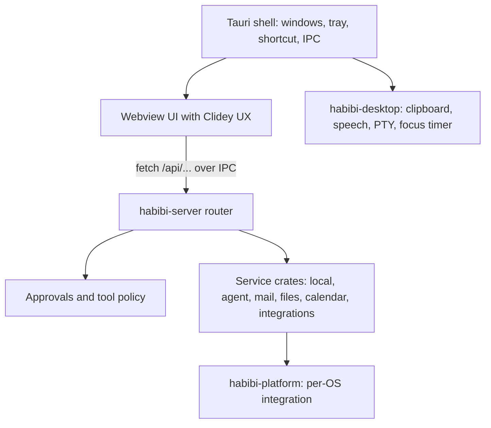

# Architecture

Habibi is a Rust backend inside a Tauri v2 shell, with a browser UI rendered in
the system webview. The UI calls the same `/api/*` routes it always has, but
there is no HTTP server: an init script routes those requests to Rust over
Tauri IPC. The same code builds for macOS, Windows, and Linux.

## Repository boundaries

| Path | Responsibility |
| --- | --- |
| `src-tauri/` | Windows, tray, global shortcut, IPC commands, the `habibi://` scheme, overlays, autostart, updater |
| `crates/habibi-core/` | Request/response contract, `Routes` and `Router`, approvals, paths, cross-service traits |
| `crates/habibi-platform/` | Per-OS integration: open, credentials, terminals, apps, system actions, previews |
| `crates/habibi-desktop/` | Clipboard history, teleprompter speech, agent PTY, focus timer, shell preferences |
| `crates/habibi-local/` | OS-facing routes, search index, files, recent items, notes, skill manifests, analytics |
| `crates/habibi-agent/` | Model providers, agent loop and tool policy, MCP, imported agent skills |
| `crates/habibi-mail/`, `habibi-files/`, `habibi-calendar/`, `habibi-integrations/` | Mail, file tools, calendars and reminders, Kubernetes/WhoDB/WhatsApp |
| `crates/habibi-server/` | Builds every service and the router |
| `crates/habibi-devserver/` | Development-only loopback HTTP host for browser UI checks; never bundled |
| `src/client/features/` | Feature controllers and workspace behavior |
| `src/client/core/`, `ui/`, `ux/`, `shared/` | Shared behavior and Clidey UX rendering |
| `skills/` | Declarative capability manifests |
| `test/` | Focused client regression tests (Rust tests live in each crate) |

Keep `app.js` and `habibi-server` as composition roots. Client features receive
navigation and provider callbacks rather than importing sibling features, and
service crates reach each other only through the traits in `habibi-core`.
Heavy workspaces are loaded when opened.

## Platform differences

Per-OS code lives only in `habibi-platform`, `habibi-desktop`, `habibi-files`,
and `src-tauri`, behind `cfg(target_os = ...)`. A capability that does not exist
on a platform returns an "unsupported" result and the UI hides or explains it.
Examples: calendars use EventKit on macOS and Google or CalDAV accounts
everywhere; OCR uses Vision, Windows.Media.Ocr, or the `tesseract` command;
teleprompter voice following is available on macOS and Windows only. The full
table is in the repository's architecture reference.

Windows and Linux builds are compile-checked and run the Rust test suite in CI,
but have not yet been run on real Windows or Linux desktops.

## Security boundaries

Only the launcher window may call the `api` and `native_message` commands; the
capability files and a label check in every command enforce that. The page is
served through the `habibi://` scheme from an explicit static-file allowlist,
so adding a file to the repository must not make it reachable. Provider
credentials stay in Rust and the system credential store.

Separate reads and draft preparation from execution. Side-effect routes must
validate the request and consume a fresh, single-use approval bound to the exact
payload. Return `{ ok, ... }` envelopes with fixed, user-safe errors and no raw
provider errors or credential material.

## Local writes and concurrency

Notes use private, atomic storage and revision checks. Bulk organization saves
the folder, note membership, and order as one transaction. Preserve those
properties when adding a new operation; do not replace them with independent
writes that can leave half a group saved. State files keep their names and JSON
shapes so existing installs keep working.

## MCP configuration

Custom MCP configuration belongs in `.habibi/mcp-servers.json` in Habibi's data
directory. For example, an existing WhoDB CLI connection can declare a stdio
transport using `whodb mcp serve --read-only`. The host still enforces its tool
policy; a configuration entry alone does not authorize arbitrary actions.

See the repository's
[architecture reference](https://github.com/clidey/habibi/blob/main/ARCHITECTURE.md)
and [Add a skill](/developers/skills).
