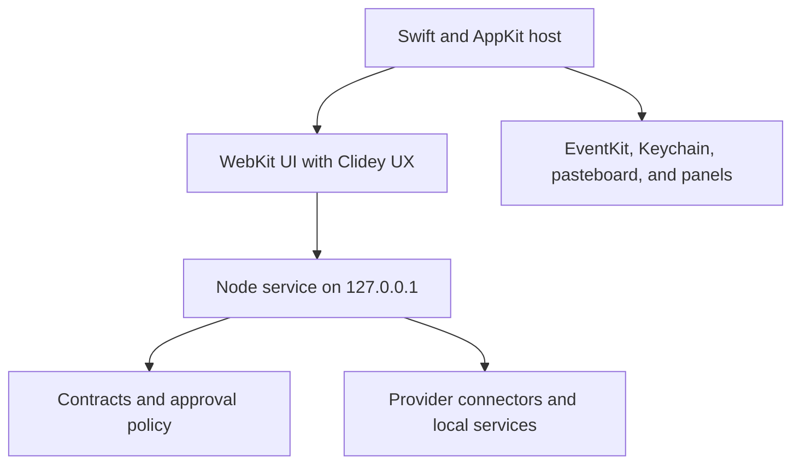

# Architecture

Habibi is a native host, an embedded WebKit UI, and a loopback Node service.
The native layer owns macOS integration; the service owns normalized domain
behavior and provider access.

## Repository boundaries

| Path | Responsibility |
| --- | --- |
| `native/` | Launcher, permissions, window lifecycle, and native adapters |
| `src/contracts/` | Public TypeScript contracts and runtime parsing |
| `src/core/` | Approval tokens, manifests, URL policy, and loopback security |
| `src/connectors/` | Provider-specific transports |
| `src/server/services/` | Domain behavior and local storage |
| `src/agent/` | Agent harness, imported workflows, and MCP integrations |
| `src/client/features/` | Feature controllers and workspace behavior |
| `src/client/core/`, `ui/`, `ux/` | Shared behavior and Clidey UX rendering |
| `skills/` | Declarative capability manifests |
| `test/` | Focused regression tests |

Keep `server.js` and `app.js` as composition roots. Client features receive
navigation and provider callbacks rather than importing sibling features.
Heavy workspaces are loaded when opened.

## Security boundaries

Preserve Host and Origin validation and the explicit static-asset allowlist.
Adding a file to the repository must not make it publicly reachable through
the local service. Provider credentials stay on the server or native side.

Separate reads and draft preparation from execution. Side-effect routes must
validate the request and the fresh approval required for that operation. Return
`{ ok, ... }` envelopes without raw provider errors or credential material.

## Local writes and concurrency

Notes use private, atomic storage and revision checks. Bulk organization saves
the folder, note membership, and order as one transaction. Preserve those
properties when adding a new operation; do not replace them with independent
writes that can leave half a group saved.

## MCP configuration

Custom MCP configuration belongs in the ignored
`.habibi/mcp-servers.json` under the data root. For example, an existing WhoDB CLI
connection can declare a stdio transport using `whodb mcp serve --read-only`.
The host still enforces read-only tool policy; a configuration entry alone does
not authorize arbitrary actions.

See the repository's
[architecture reference](https://github.com/clidey/habibi/blob/main/ARCHITECTURE.md)
and [Add a skill](/developers/skills).
